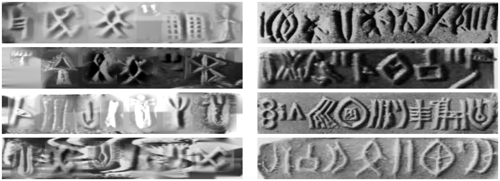

# M1 · Synthetic inscriptions from real sign crops (#32)

The professor's suggestion: cut real signs out (using the team's hand-drawn boxes) and paste them, in the order of real corpus texts, onto real seal surfaces. `src/indus/composite.py` explains how a composite is made; `scripts/make_composites.py` builds them.

**What went in.** Only training seals: 2,240 sign crops of 336 Wells signs from 459 training seals, and 459 sign-free backgrounds (each seal's text band with its signs painted out by OpenCV inpainting). Sequences: the 1,260 ICIT texts whose signs all have a real crop, after removing every text that occurs on a validation, test or Harappa seal. 5,000 composites, seed 0. Each comes with its sequence and box positions (also as YOLO labels for the detector).

Left: composites. Right: real training bands. The composites are recognisable but patchier: crops carry their own lighting and the inpainted stone is smoother than real stone.

## Does it help the whole-band reader (CRNN + CTC)?

Both runs on the same CPU with seed 0, the same initial CNN (`wells_all.pt`) and the same settings; the only difference is up to one composite per real training band per epoch. Model selection on the 67 validation seals.

| Training data | Test SER ↓ | Test exact | Test count right | Harappa SER ↓ | Harappa exact | Harappa count right |
| --- | ---: | ---: | ---: | ---: | ---: | ---: |
| Real bands only (`m1_crnn_real_cpu.md`) | 55.4% | 4.3% | 27.7% | 57.9% | 5.5% | 29.3% |
| Real bands + 5,000 composites (`m1_crnn_composites.md`) | **54.4%** | 3.5% | **29.1%** | **53.2%** | **7.7%** | **35.9%** |

SER: sign error rate (insertions + deletions + substitutions, over reference signs). For reference, cut-and-classify with the true count has 68.1% SER on test.

**Reading.** On in-site test seals the gain is small (1 point SER, within single-seed noise of a few points). On Harappa, a site never used for training, composites cut SER by 4.7 points and raise exact readings from 10 to 14 of 181 seals and correct counts from 53 to 65. That fits what composites add: many more sign arrangements and backgrounds than the 466 real bands, which matters most when the test photos differ from the training ones. One seed; a second seed would firm this up.
